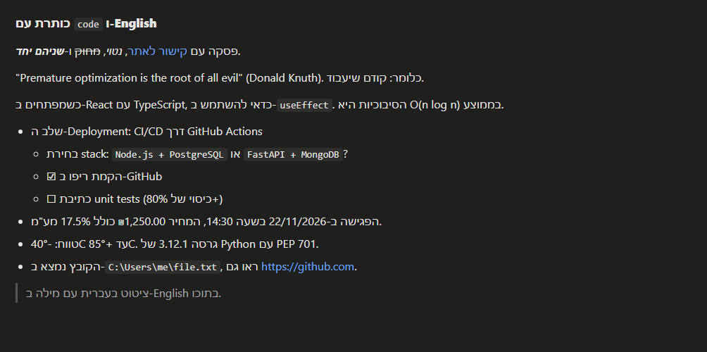
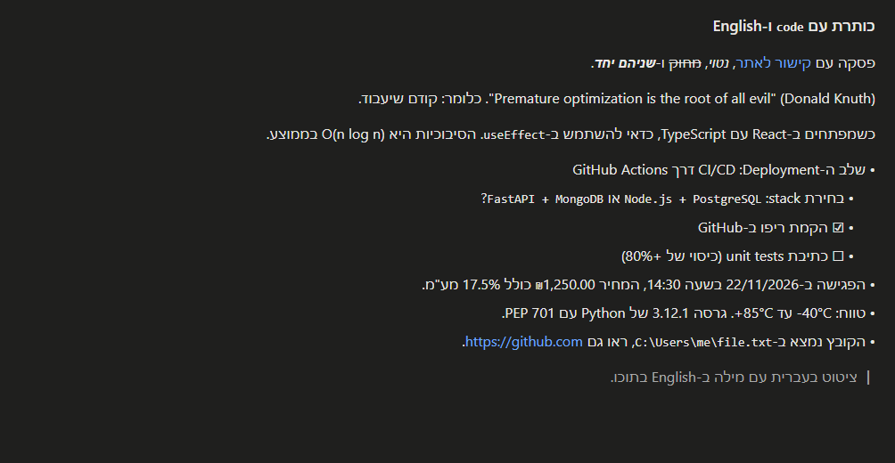

# hebrew-rtl-replies

**[English](#english)** · Works for Arabic and Persian too.

<div dir="rtl">

תוסף שמציג את התשובות של <span dir="ltr">Claude</span> בעברית **מימין לשמאל**, מיושרות לימין ועם סימני פיסוק במקום הנכון. קוד, טבלאות ופסקאות באנגלית נשארים משמאל לימין. התוסף עובד באפליקציה למחשב, בלשונית <span dir="ltr">Code</span>.

בלי התוסף, תשובה בעברית מוצגת משמאל לימין: השורות מיושרות לשמאל, נקודות וסוגריים קופצים לצד הלא נכון, ומילים באנגלית בתוך משפט בעברית מבלבלות את הסדר.

**לפני**



**אחרי**



## התקנה

צריך גרסה עדכנית של <span dir="ltr">Claude Code</span>. התוסף משתמש ביכולת חדשה, וגרסאות ישנות מתקינות אותו אבל לא מצליחות לטעון אותו. האפליקציה למחשב מתעדכנת לבד.

**1. פתחו טרמינל והריצו את שתי הפקודות האלה, אחת אחרי השנייה.** במחשב <span dir="ltr">Windows</span> הטרמינל הוא <span dir="ltr">PowerShell</span>, ובמק הוא <span dir="ltr">Terminal</span>.

</div>

```
claude plugin marketplace add yitzhak-rose/hebrew-rtl-replies
claude plugin install hebrew-rtl-replies@hebrew-rtl-replies
```

<div dir="rtl">

**2. סגרו ופתחו מחדש את האפליקציה.** מעכשיו התוסף פועל בכל שיחה חדשה.

אם הטרמינל עונה שהפקודה <code dir="ltr">claude</code> לא קיימת, צריך קודם להתקין את <span dir="ltr">Claude Code</span> לפי [הוראות ההתקנה](https://code.claude.com/docs/en/setup). אם הגרסה ישנה, מעדכנים אותה עם הפקודה <code dir="ltr">claude update</code>. מי שהתקין דרך <span dir="ltr">winget</span> מעדכן עם <code dir="ltr">winget upgrade Anthropic.ClaudeCode</code>.

**אפשר גם מתוך שיחה של <span dir="ltr">Claude Code</span> בטרמינל:**

</div>

```
/plugin marketplace add yitzhak-rose/hebrew-rtl-replies
/plugin install hebrew-rtl-replies@hebrew-rtl-replies
```

<div dir="rtl">

**כיבוי או הסרה:** באפליקציה לוחצים על הפלוס ליד תיבת ההודעה, ואז <span dir="ltr">**Plugins** → **Manage plugins**</span>. בטרמינל מסירים כך:

</div>

```
claude plugin uninstall hebrew-rtl-replies@hebrew-rtl-replies
```

<div dir="rtl">

## מה מטופל

- פסקאות שנפתחות באות עברית, או שרובן עברית, מוצגות מימין לשמאל. שאר הפסקאות לא משתנות.
- מילים באנגלית בתוך משפט בעברית נשארות יחד ובסדר הנכון, למשל <span dir="ltr">GitHub Actions</span> או <span dir="ltr">O(n log n)</span>.
- אות שימוש עם מקף לפני מילה באנגלית, כמו ב-<span dir="ltr">React</span>.
- נקודה, פסיק, נקודתיים וסימן שאלה אחרי מילה באנגלית חוזרים לצד הנכון של המשפט.
- מספרים, תאריכים, שעות, אחוזים ומחירים.
- מודגש, נטוי, מחוק, קוד בתוך שורה, קישורים, תמונות וכתובות אינטרנט.
- כותרות, רשימות, רשימות מקוננות, תיבות סימון, ציטוטים וקו מפריד.
- בלוקי קוד וטבלאות נשארים כמו שהאפליקציה מציגה אותם.
- עובד גם בערבית ובשפות אחרות שנכתבות מימין לשמאל.

## מגבלות ידועות

- רק באפליקציה למחשב. בטרמינל אין צורך, כי הוא מסדר עברית בעצמו. בתוסף של <span dir="ltr">VS Code</span> ובטלפון התוסף לא פועל, כי הוא לא נבדק שם.
- הגופן בפסקאות בעברית שונה מעט מהגופן הרגיל של האפליקציה, וקוד בתוך שורה מוצג בלי רקע אפור.
- רק התשובות של <span dir="ltr">Claude</span> מושפעות. ההודעות שאתם כותבים נשארות כמו שהן.
- שורה ארוכה של אנגלית בלבד בתוך פסקה בעברית נשברת כמו טקסט באנגלית.
- הערות בעברית בתוך בלוק קוד נשארות משמאל לימין. זה בכוונה: כדי לתקן אותן צריך להוסיף לקוד תווים בלתי נראים, והם היו מועתקים יחד עם הקוד.
- **העתקה:** מילים באנגלית, קוד, שמות קבצים ומספרים מועתקים נקיים. מילה בעברית עם סימן פיסוק צמוד אליה, וסוגריים, מועתקים עם תו כיוון בלתי נראה. כשמעתיקים משפט בעברית למקום שחייב טקסט מדויק, כמו שם קובץ או קוד, כדאי להעתיק מבלוק קוד או להקליד מחדש.

## משוב ודיווח על תקלות

משהו מוצג לא נכון, או שיש לכם רעיון? [פתחו דיווח חדש](https://github.com/yitzhak-rose/hebrew-rtl-replies/issues/new). כדי שיהיה אפשר לתקן, צרפו צילום מסך ואת הטקסט שהוצג לא נכון. אפשר להעתיק אותו מהתשובה של <span dir="ltr">Claude</span>.

## הסרת אחריות

**התוסף ניתן בחינם, כמות שהוא, ללא אחריות מכל סוג.** השימוש בו הוא באחריותכם בלבד. היוצר אינו אחראי לשום נזק, תקלה, אובדן מידע או כל תוצאה אחרת שנובעים מהתוסף, מהשימוש בו או מחוסר היכולת להשתמש בו, ישירות או בעקיפין, גם אם הוא ידע על אפשרות כזו. אין התחייבות לתמיכה, לתיקונים או לעדכונים. התוסף אינו מוצר רשמי של <span dir="ltr">Anthropic</span> ואינו קשור אליה. הנוסח המחייב הוא של רישיון <span dir="ltr">MIT</span> שבקובץ [הרישיון](LICENSE).

</div>


---

## English

A plugin for Claude Code in the Claude desktop app (Code tab). It draws Claude's Hebrew replies right to left, aligned right, with punctuation where it belongs. Code blocks, tables and English paragraphs stay left to right. Arabic and other right-to-left scripts work too.

**Install.** Needs a recent Claude Code: the plugin uses a new hooks feature, and older versions install it but cannot load it. In a terminal, run:

```
claude plugin marketplace add yitzhak-rose/hebrew-rtl-replies
claude plugin install hebrew-rtl-replies@hebrew-rtl-replies
```

Then restart the Claude desktop app. Inside a Claude Code terminal session, `/plugin marketplace add yitzhak-rose/hebrew-rtl-replies` and `/plugin install hebrew-rtl-replies@hebrew-rtl-replies` do the same. No `claude` command? See the [setup guide](https://code.claude.com/docs/en/setup). Old version? Run `claude update`, or `winget upgrade Anthropic.ClaudeCode` if you installed it with winget.

**Turn off or remove:** in the desktop app, **+** next to the prompt box → **Plugins** → **Manage plugins**, or `claude plugin uninstall hebrew-rtl-replies@hebrew-rtl-replies`.

**How it works.** A `ui.render` hook on `AssistantMessage` (desktop surface only) cuts the reply into blocks. Fences, tables and left-to-right paragraphs go back to the app's own Markdown renderer. A right-to-left paragraph is cut into lines, and each line into items: a right-to-left word, a run of English kept together with the symbols, numbers and brackets inside it, a number, a symbol, or a link. The items are laid out in a `row-reverse` wrapping row, so lines start and wrap at the right edge. Each item's text is wrapped in Unicode embedding marks (RLE/LRE … PDF) so its letters order correctly. The parsing logic is in `hooks/rtl.ts`; drawing is in `hooks/register.tsx`.

**Tests:** `claude plugin test .` (unit tests for the parser in `test/rtl.test.ts`, render tests in `test/render.test.tsx`).

**Limitations:** desktop app only; slightly different font in right-to-left paragraphs; inline code has no background there; only Claude's replies are affected; Hebrew comments inside code blocks stay left to right, on purpose, since fixing them would put invisible direction marks into code you copy. **Copying:** English words, code, file names and numbers copy clean; a Hebrew word with punctuation on its edge, and brackets, copy with an invisible direction mark, so for text that must be exact (a file name, code), copy from a code block or retype it.

## Feedback

Something drawn wrong, or an idea? [Open an issue](https://github.com/yitzhak-rose/hebrew-rtl-replies/issues/new) with a screenshot and the text that was drawn wrong (copy it from Claude's reply).

## Disclaimer

**This plugin is provided free of charge, "AS IS", without warranty of any kind.** You use it entirely at your own risk. The author is not liable for any damage, malfunction, data loss or other consequence arising from the plugin, its use or inability to use it, whether direct or indirect, even if advised of the possibility. No support, fixes or updates are promised. This is not an official Anthropic product and is not affiliated with Anthropic. The binding terms are those of the MIT License in [LICENSE](LICENSE).

License: MIT.
